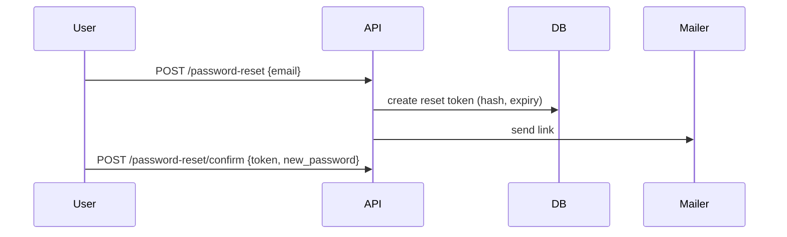

# AI-Assisted Software Development: An Overview Tutorial

## 1. Introduction

**AI-assisted software development** means using AI tools, mostly large language models (LLMs), to help plan, write, review, test, debug, document and maintain software. The developer stays responsible for the result. The AI speeds up the work.

**Learning objectives.** After this tutorial you will be able to:
- Explain what AI-assisted development is and how the tools work.
- Recognize the main categories of tools and where each fits.
- Apply AI at every phase of the software development life cycle (SDLC).
- Write effective prompts and give tools good context.
- Review, test and secure AI-generated code.
- Avoid common pitfalls and adopt it responsibly in a team.

**Prerequisites:** basic programming knowledge and familiarity with Git.

---

## 2. Background: How Did We Get Here?

| Era | Assistance | Example |
|---|---|---|
| 1980s-2000s | Syntax highlighting, compilers, linters | IDE basics |
| 2000s-2010s | Autocomplete based on static analysis | IntelliSense |
| 2010s | Search and community answers | Stack Overflow |
| ~2021 | LLM-based inline code completion | Copilot-style tools |
| ~2023 | Conversational chat inside the IDE | Chat assistants |
| 2024 onward | **Agents** that read a codebase, edit files, run commands and tests, and iterate | Agentic coding tools |

The trend: from *completing the next token* to *completing the task*.

---

## 3. Core Concepts

### 3.1 Large Language Models (LLMs)
Models trained on text and code that predict the next token. They can generate code, explain it, translate between languages and reason about problems. They are **probabilistic**: output can be fluent but wrong.

### 3.2 Prompt
The instruction you give the model. Quality of output depends heavily on prompt quality.

### 3.3 Context window
The amount of text (prompt, files, history, tool output) the model can consider at once. If something is not in context, the model does not know it.

### 3.4 Tokens
The units the model reads and writes. Cost, speed and context limits are measured in tokens.

### 3.5 Hallucination
Confident but incorrect output, such as a function or library that does not exist, or a wrong API signature. The main reason AI output must be verified.

### 3.6 Tools and agents
- **Tool use:** the model can call functions (read a file, run tests, search the web).
- **Agent:** a loop where the model plans, uses tools, observes results and continues until the goal is met.

### 3.7 Retrieval and grounding (RAG)
Feeding the model relevant documents or code at query time so answers are based on your actual project, not only training data.

### 3.8 MCP (Model Context Protocol)
An open standard that lets AI applications connect to external tools and data sources (issue trackers, databases, docs) in a uniform way.

---

## 4. Architecture: How an AI Coding Assistant Works

```
 ┌───────────┐   prompt + selected context    ┌──────────────────┐
 │ Developer │ ─────────────────────────────▶ │  Assistant client│
 │ (IDE/CLI) │ ◀───────────────────────────── │  (IDE plugin/CLI)│
 └───────────┘      suggestions / edits       └───────┬──────────┘
                                                      │
                          ┌───────────────────────────┼─────────────────────────┐
                          ▼                           ▼                         ▼
                 ┌─────────────────┐        ┌──────────────────┐      ┌──────────────────┐
                 │ Context builder │        │  LLM (model API) │      │ Tools (via MCP)  │
                 │ files, git diff,│        │ reasoning, code  │      │ shell, tests,    │
                 │ project rules   │        │ generation       │      │ search, tickets  │
                 └─────────────────┘        └──────────────────┘      └──────────────────┘
```

**Typical agent loop**

```
1. Understand the request
2. Gather context (read files, search code)
3. Plan the change
4. Edit code
5. Run tests / linter / build
6. Read the results, fix problems, repeat
7. Present a diff for human review
```

---

## 5. Categories of AI Development Tools

| Category | What it does | Best for |
|---|---|---|
| **Inline completion** | Suggests the next lines as you type | Boilerplate, repetitive code |
| **Chat assistant** | Q&A about code, snippets, explanations | Learning, quick questions |
| **Agentic coding tools** | Make multi-file changes, run commands and tests | Features, refactors, bug fixes |
| **AI code review** | Comments on pull requests | Catching issues early |
| **AI test generation** | Drafts unit and integration tests | Raising coverage |
| **AI documentation tools** | Writes docs, comments, changelogs | Keeping docs current |
| **Low-code / app generators** | Builds prototypes from descriptions | Prototypes and MVPs |
| **Security scanners with AI** | Finds and explains vulnerabilities | DevSecOps |

Tools change quickly. Evaluate on your own codebase, not on marketing demos.

---

## 6. AI Across the Software Development Life Cycle

### 6.1 Requirements and planning
- Turn rough ideas into user stories and acceptance criteria.
- Spot ambiguities and missing edge cases.
- Draft a technical plan for review.

> **Prompt:** "Here is a feature request: *users can reset passwords by email*. List user stories, acceptance criteria, edge cases and security considerations."

### 6.2 Design and architecture
- Compare design options and trade-offs.
- Draft diagrams (sequence, component) as text such as Mermaid.
- Suggest data models and API contracts.



### 6.3 Implementation
- Generate functions, classes and boilerplate.
- Translate code between languages or frameworks.
- Scaffold new modules following existing patterns.

### 6.4 Testing
- Generate unit tests, edge cases and test data.
- Suggest property-based tests.
- Explain failing tests.

### 6.5 Debugging
- Explain stack traces and error messages.
- Propose hypotheses and a minimal reproduction.
- Trace a bug through multiple files (agents).

### 6.6 Code review and refactoring
- Summarize pull requests.
- Flag bugs, complexity, duplicated logic and missing tests.
- Perform mechanical refactors across many files.

### 6.7 Documentation
- Write docstrings, READMEs, API docs and runbooks.
- Generate release notes from commit history.

### 6.8 DevOps and operations
- Draft CI pipelines, Dockerfiles and infrastructure-as-code.
- Summarize logs and incidents; propose runbook steps.

---

## 7. Hands-On Walkthrough

We will build a small function with an AI assistant, using a disciplined workflow.

### Step 1: State the goal and constraints

```
Write a Python function `is_valid_username(name: str) -> bool`.
Rules: 3-16 characters, letters, digits and underscore only,
must not start with a digit. No external libraries.
Include type hints and a docstring.
```

### Step 2: Review what comes back (never accept blindly)

```python
import re

_USERNAME_RE = re.compile(r"^[A-Za-z_][A-Za-z0-9_]{2,15}$")

def is_valid_username(name: str) -> bool:
    """Return True if name is 3-16 chars, uses only letters, digits and
    underscore, and does not start with a digit."""
    return bool(_USERNAME_RE.fullmatch(name))
```

Checklist while reviewing:
- Does it meet every stated rule? (length 3-16: first char plus 2-15 more, yes)
- Edge cases: empty string, 17 characters, unicode letters, trailing newline?
  - Note `$` allows a trailing newline, which is why `fullmatch` is used here.
- Is it readable and consistent with our codebase style?

### Step 3: Ask the AI to write tests, then check the tests too

```python
import pytest
from usernames import is_valid_username

@pytest.mark.parametrize("name,expected", [
    ("abc", True),
    ("a_1", True),
    ("ab", False),                 # too short
    ("a" * 17, False),             # too long
    ("1abc", False),               # starts with digit
    ("ab-c", False),               # invalid char
    ("abc\n", False),              # trailing newline
    ("", False),
])
def test_username(name, expected):
    assert is_valid_username(name) is expected
```

### Step 4: Run it yourself

```bash
pytest -q
```

### Step 5: Commit in small, reviewed pieces

```bash
git switch -c feat/username-validation
git add usernames.py test_usernames.py
git commit -m "feat: add username validation with tests"
```

The key habit: **generate, read, test, then commit.**

---

## 8. Prompting and Context Engineering

### 8.1 Anatomy of a good prompt

| Element | Example |
|---|---|
| **Goal** | "Add pagination to the `/orders` endpoint" |
| **Context** | "Express + TypeScript; see `routes/orders.ts` and `db/orders.ts`" |
| **Constraints** | "Cursor-based, default limit 20, max 100; no new dependencies" |
| **Format** | "Show a diff only; explain trade-offs in 3 bullets" |
| **Acceptance** | "Existing tests must pass; add tests for limit and cursor" |

### 8.2 Weak vs strong prompts

| Weak | Strong |
|---|---|
| "Fix this bug" | "`GET /orders?status=paid` returns 500 when `status` is missing. Stack trace below. Find the root cause and propose a minimal fix." |
| "Write tests" | "Write pytest tests for `parse_date()` covering ISO strings, empty input, invalid month and time zones." |
| "Make it better" | "Refactor `process_payment()` to remove duplicated validation; keep public behaviour unchanged." |

### 8.3 Techniques that work
- **Be specific** about language, framework, version and style.
- **Give examples** of input and expected output.
- **Break big tasks** into small steps; review each.
- **Ask for a plan first**, then approve it before code is written.
- **Iterate:** refine with follow-ups instead of starting over.
- **Ask for reasoning and alternatives** on design decisions.
- **Provide project rules** in a persistent file (conventions, commands to run tests, architecture notes). Many tools read a file such as `CLAUDE.md` or `AGENTS.md` for this.

### 8.4 Example project rules file

```markdown
# Project guide for AI assistants
- Language: TypeScript (strict), Node 20
- Run tests: `npm test`   Lint: `npm run lint`
- Follow existing patterns in `src/services/`
- Never edit generated files in `src/gen/`
- All new endpoints need input validation and tests
```

---

## 9. Reviewing and Validating AI Output

Treat AI output like a pull request from a fast but inexperienced teammate.

**Review checklist**
1. **Correctness:** does it do what was asked, including edge cases?
2. **Existence:** do the imported libraries and called APIs really exist in your version?
3. **Tests:** are there tests, and do they fail when the code is wrong?
4. **Security:** input validation, injection, authentication, secrets, unsafe deserialization.
5. **Performance:** needless loops, N+1 queries, memory use.
6. **Maintainability:** naming, duplication, fits the codebase style.
7. **Licensing:** is generated code too close to a known licensed source?
8. **Scope:** did it change only what you asked for?

**Verification commands**

```bash
git diff                      # read every change
npm test            # or: pytest, go test ./..., mvn test
npm run lint
npm audit           # or: pip-audit, trivy, etc.
```

---

## 10. Security, Privacy and Compliance

| Risk | Mitigation |
|---|---|
| Leaking secrets or customer data into prompts | Never paste credentials or personal data. Use approved, enterprise tools with data-handling terms. |
| Insecure generated code | Security review, SAST/DAST scanners, tests for abuse cases |
| Vulnerable or fake dependencies (including "slopsquatting": packages hallucinated and then maliciously registered) | Verify packages exist and are reputable before installing; pin versions |
| Prompt injection (malicious instructions hidden in files, web pages or issues the agent reads) | Limit agent permissions, review actions, treat external content as data |
| Over-privileged agents | Least privilege, sandboxing, approvals for destructive commands |
| License and IP concerns | Follow company policy; use tools with IP indemnity where required |

Add secret scanning (for example in pre-commit and CI) as a safety net.

---

## 11. Benefits and Limitations

| Benefits | Limitations |
|---|---|
| Faster boilerplate, tests and docs | Hallucinations and subtle bugs |
| Lower friction learning new languages or codebases | Limited context on large systems |
| Consistent first drafts and refactors | Can reinforce bad patterns or outdated practices |
| More time for design and problem-solving | Over-reliance can erode skills |
| Better coverage of edge cases when prompted | Security, privacy and licensing risks |

**Where AI shines:** well-defined, well-documented, repetitive or boilerplate tasks, test scaffolding, explaining unfamiliar code.
**Where to be careful:** novel algorithms, security-critical logic, concurrency, performance-critical code, architecture decisions with business trade-offs.

---

## 12. Best Practices for Developers

1. **You own the code.** If you can't explain it, don't ship it.
2. **Work in small steps** and commit often so mistakes are easy to revert.
3. **Use version control** as your safety net; review diffs before accepting.
4. **Run tests and linters** on every AI change.
5. **Give context and rules**, and keep a project guide file up to date.
6. **Use AI to learn**, not only to produce: ask "why" and "what are the alternatives".
7. **Keep sensitive data out** of prompts.
8. **Verify claims**: check docs for APIs and versions.
9. **Disclose and document** AI use according to team policy.
10. **Keep practising fundamentals**: algorithms, debugging, reading code.

---

## 13. Adopting AI in a Team

| Stage | Actions |
|---|---|
| **Pilot** | Pick 1-2 tools, a small team and measurable goals |
| **Policy** | Define allowed tools, data rules, review requirements, licensing stance |
| **Enablement** | Train on prompting, review and security; share a prompt and rules library |
| **Integration** | Add AI review and test generation to CI; standardize project guide files |
| **Measure** | Track cycle time, defect rate, review time, developer satisfaction |
| **Iterate** | Adjust based on data, not hype |

**Metrics to watch:** lead time, change failure rate, time to review, test coverage, escaped defects, developer experience. Be wary of vanity metrics such as raw lines of code generated.

---

## 14. Real-World Use Cases

| Use case | How AI helps | Human responsibility |
|---|---|---|
| **Legacy code understanding** | Summarizes modules, maps dependencies, explains cryptic code | Validate against behaviour and tests |
| **Framework migration** (e.g. library upgrade) | Applies mechanical changes across many files | Review diffs, run full test suite |
| **Bug triage** | Reads stack traces and logs, proposes root causes | Confirm and fix properly |
| **Test backfill** | Drafts tests for untested code | Check the tests assert real behaviour |
| **API integration** | Generates client code from an OpenAPI spec | Handle auth, errors, rate limits |
| **Onboarding** | Answers "where is X handled?" questions | Keep docs accurate |
| **Documentation** | Drafts READMEs and runbooks from code | Fact-check and maintain |
| **Prototyping** | Builds a quick demo from a description | Rewrite to production standards |

---

## 15. Common Pitfalls

- **Accepting without reading** ("vibe coding" into production).
- **Vague prompts** leading to generic or wrong code.
- **Huge one-shot requests** that produce unreviewable diffs.
- **Trusting generated tests** that only mirror the generated code.
- **Ignoring versions** and getting deprecated or non-existent APIs.
- **Pasting secrets** into prompts.
- **Letting agents run unchecked** with broad permissions.
- **Skipping the learning:** using AI to avoid understanding.

---

## 16. Exercises

1. **Explain:** Take an unfamiliar function from your codebase. Ask an assistant to explain it, then verify the explanation by reading the code and running it.
2. **Prompt rewrite:** Rewrite "write a login function" into a prompt with goal, context, constraints, format and acceptance criteria.
3. **Spot the bug:** Ask an assistant for a date-parsing function. List three edge cases it may have missed and write tests for them.
4. **Hallucination hunt:** Ask for code using a library you know well. Check each import and method against official docs.
5. **Agent task:** In a throwaway Git branch, ask an agent to add a small feature plus tests. Review the full diff and write down what you'd change.
6. **Policy draft:** Write a one-page AI usage policy for a small team covering data, review and licensing.

---

## 17. Quick Quiz

1. What is a hallucination, and how do you guard against it?
2. Why does context matter to an AI coding assistant?
3. What distinguishes an *agent* from simple code completion?
4. Name three items on a review checklist for AI-generated code.
5. Why is committing in small steps especially valuable with AI tools?
6. What is prompt injection and how can you reduce its risk?

<details>
<summary>Answers</summary>

1. Confident but incorrect output; verify with docs, tests and code review.
2. The model only knows what is in its context window; better context gives more accurate, project-specific results.
3. An agent plans, uses tools (edit files, run tests), observes results and iterates toward a goal.
4. Correctness, security, tests, existence of APIs, maintainability, scope, licensing (any three).
5. Small commits make review easier and mistakes easy to revert.
6. Malicious instructions hidden in content the AI reads; limit permissions, treat external content as data, require approval for risky actions.
</details>

---

## 18. Glossary

| Term | Meaning |
|---|---|
| **LLM** | Large language model |
| **Prompt** | The instruction and context sent to the model |
| **Context window** | The maximum text the model can consider at once |
| **Token** | A unit of text processed by the model |
| **Hallucination** | Plausible but false output |
| **Agent** | A model that plans and acts with tools in a loop |
| **RAG** | Retrieval-augmented generation: adding retrieved documents to the prompt |
| **MCP** | Model Context Protocol for connecting AI apps to tools and data |
| **Prompt injection** | Malicious instructions embedded in content the model processes |
| **SAST/DAST** | Static / dynamic application security testing |

---

## 19. Summary

- AI-assisted development uses LLMs and agents to speed up every SDLC phase.
- The developer remains accountable: **generate, review, test, then commit.**
- Good results depend on clear prompts, rich context and project rules.
- Verify everything: correctness, security, dependencies and licensing.
- Adopt gradually with policy, training and measurement.
- Fundamentals still matter. AI amplifies skill; it doesn't replace judgement.
