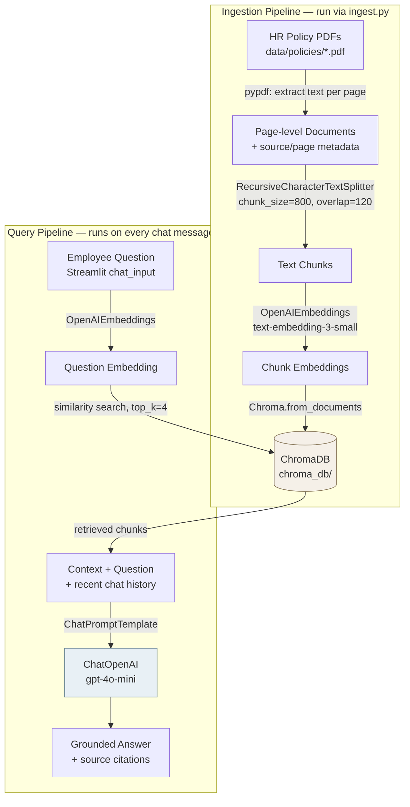
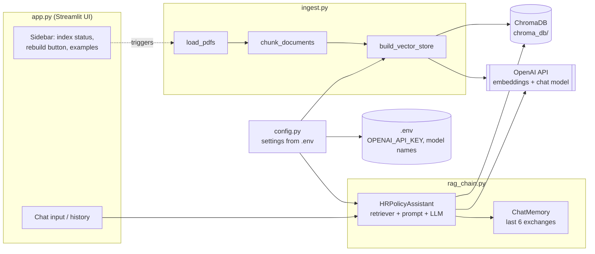

# HR Policy Assistant (RAG) — Beginner Replication Guide

A step-by-step guide to build, from an empty folder, an AI-powered HR Policy Assistant that
answers employee questions (leave, work-from-home, payroll) by retrieving relevant passages from
HR policy PDFs and generating a grounded answer with an LLM — Retrieval-Augmented Generation
(RAG), using Python + LangChain + ChromaDB + OpenAI + Streamlit.

---

## Table of Contents

1. [What You'll Build](#1-what-youll-build)
2. [High-Level Workflow](#2-high-level-workflow)
3. [Application Architecture](#3-application-architecture)
4. [Prerequisites](#4-prerequisites)
5. [Step-by-Step Build](#5-step-by-step-build)
6. [Running the Project](#6-running-the-project)
7. [Troubleshooting](#7-troubleshooting)
8. [Next Steps](#8-next-steps)

---

## 1. What You'll Build

A Streamlit chat app where an employee can ask things like *"How many paid leaves are allowed
annually?"* or *"When is salary credited?"* and get a short, accurate answer sourced directly from
the company's HR policy PDFs — with the source document and page number shown, instead of the
employee having to read multiple PDFs or email HR.

The project has two pipelines:

- **Ingestion pipeline** (`ingest.py`, run once or whenever policies change): PDFs → extracted
  text → chunks → OpenAI embeddings → stored in a local ChromaDB vector database.
- **Query pipeline** (`app.py` + `rag_chain.py`, runs on every chat message): question → embedding
  → similarity search in ChromaDB → relevant chunks + question sent to an OpenAI chat model →
  grounded answer.

---

## 2. High-Level Workflow

| # | Step | Where |
|---|------|-------|
| 1 | Load every PDF in `data/policies/` | `ingest.py` |
| 2 | Extract text per page | `ingest.py` |
| 3 | Split text into overlapping chunks | `ingest.py` |
| 4 | Generate OpenAI embeddings for each chunk | `ingest.py` |
| 5 | Store embeddings + chunk text + metadata in ChromaDB | `ingest.py` |
| 6 | Accept an employee question | `app.py` |
| 7 | Convert the question into an embedding | `rag_chain.py` (via retriever) |
| 8 | Search ChromaDB for relevant chunks | `rag_chain.py` |
| 9 | Send retrieved context + question (+ chat history) to the LLM | `rag_chain.py` |
| 10 | Generate an answer grounded in the retrieved policy text | `rag_chain.py` |

Steps 1–5 run once (ingestion). Steps 6–10 run on every question (query time).

```
PDFs → extract text → chunk → embed → ChromaDB
                                          │
employee question → embed → similarity search ──┘
                                          │
                              context + question → LLM → answer
```

---

## 3. Application Architecture

### 3.1 Data flow diagram



### 3.2 Component / file architecture



### 3.3 Project structure

```
HRPolicyAssistant/
├── app.py                      # Streamlit chat UI
├── ingest.py                   # PDF → chunks → embeddings → ChromaDB
├── rag_chain.py                # Retrieval + prompt + LLM + memory (the RAG chain)
├── config.py                   # Settings loaded from .env
├── generate_sample_pdfs.py     # Creates 3 sample HR policy PDFs
├── data/policies/              # Drop your HR policy PDFs here
│   ├── Leave_Policy.pdf
│   ├── WFH_Policy.pdf
│   └── Payroll_and_Salary_Policy.pdf
├── chroma_db/                  # Created automatically by ingest.py (vector store)
├── requirements.txt
├── .env.example
└── .gitignore
```

---

## 4. Prerequisites

- **Python 3.10+** installed (`python3 --version`).
- **An OpenAI API key** with billing enabled — get one at platform.openai.com. Embeddings and
  chat completions both cost a small amount per call.
- Basic comfort with a terminal.
- macOS/Linux commands are shown below; on Windows, activate the venv with
  `venv\Scripts\activate` instead of `source venv/bin/activate`.

> **Tip:** if you use `conda`, make sure you `conda deactivate` before creating/activating the
> project's `venv` — mixing conda's base environment with a `venv` is a common source of
> "it says installed but Python can't find it" errors (see Troubleshooting).

---


## 5. Step-by-Step Build

### Step 1 — Create the project folder and a virtual environment

```bash
mkdir HRPolicyAssistant && cd HRPolicyAssistant
python3 -m venv venv
source venv/bin/activate      # Windows: venv\Scripts\activate
```

Your prompt should now show `(venv)`.

### Step 2 — Create `requirements.txt`

These exact versions are pinned because this combination is verified to work together — newer
`openai`/`httpx`/`langchain` releases can break compatibility with each other (see
Troubleshooting for what goes wrong and why).

```text
streamlit==1.39.0
langchain==0.3.7
langchain-core==0.3.15
langchain-text-splitters==0.3.2
langchain-openai==0.2.6
langchain-chroma==0.1.4
chromadb==0.5.20
openai==1.54.4
httpx==0.27.2
pypdf==5.1.0
python-dotenv==1.0.1
tiktoken==0.8.0
reportlab==4.2.5
```

Install everything:

```bash
pip install -r requirements.txt
```

### Step 3 — Create `.env.example` and `.env`

`.env.example` (safe to commit — no real key):

```text
# Copy this file to .env and fill in your own key:
#   cp .env.example .env
OPENAI_API_KEY=your_openai_api_key_here

# Optional overrides (defaults shown)
EMBEDDING_MODEL=text-embedding-3-small
CHAT_MODEL=gpt-4o-mini
LLM_TEMPERATURE=0.1
CHUNK_SIZE=800
CHUNK_OVERLAP=120
TOP_K=4
```

Then create your real `.env` (never commit this one):

```bash
cp .env.example .env
```

Edit `.env` and replace `your_openai_api_key_here` with your real key (starts with `sk-...`).

### Step 4 — `.gitignore`

```text
venv/
__pycache__/
*.pyc
.env
chroma_db/
```

### Step 5 — `config.py` (shared settings, single source of truth)

```python
"""
Shared configuration for the HR Policy Assistant RAG app.
Reads settings from environment variables (loaded from a local .env file).
"""
import os
import httpx
from dotenv import load_dotenv

load_dotenv()

# --- Paths -------------------------------------------------------------
BASE_DIR = os.path.dirname(os.path.abspath(__file__))
POLICIES_DIR = os.path.join(BASE_DIR, "data", "policies")
CHROMA_DIR = os.path.join(BASE_DIR, "chroma_db")
COLLECTION_NAME = "hr_policies"

# --- OpenAI --------------------------------------------------------------
OPENAI_API_KEY = os.getenv("OPENAI_API_KEY", "")
EMBEDDING_MODEL = os.getenv("EMBEDDING_MODEL", "text-embedding-3-small")
CHAT_MODEL = os.getenv("CHAT_MODEL", "gpt-4o-mini")
LLM_TEMPERATURE = float(os.getenv("LLM_TEMPERATURE", "0.1"))

# --- Chunking --------------------------------------------------------------
CHUNK_SIZE = int(os.getenv("CHUNK_SIZE", "800"))
CHUNK_OVERLAP = int(os.getenv("CHUNK_OVERLAP", "120"))

# --- Retrieval --------------------------------------------------------------
TOP_K = int(os.getenv("TOP_K", "4"))


def require_api_key():
    if not OPENAI_API_KEY or OPENAI_API_KEY == "your_openai_api_key_here":
        raise RuntimeError(
            "OPENAI_API_KEY is not set. Copy .env.example to .env and add your key, "
            "or set it as an environment variable before running this app."
        )


def new_http_client() -> httpx.Client:
    """
    Build a plain httpx.Client ourselves and hand it to OpenAI/OpenAIEmbeddings via the
    `http_client=` argument. This sidesteps a version-mismatch bug where older `openai`
    releases (<1.55.3) try to pass a `proxies=` kwarg into httpx.Client(), which newer
    httpx releases (>=0.28) reject with:
        TypeError: Client.__init__() got an unexpected keyword argument 'proxies'
    Supplying our own client avoids that code path entirely, regardless of which
    openai/httpx versions ended up installed.
    """
    return httpx.Client(timeout=60.0)


def new_async_http_client() -> httpx.AsyncClient:
    """
    Same fix as new_http_client(), but for the *async* httpx client. langchain_openai
    builds both a sync client and an async client under the hood, even if the app only
    ever uses the sync methods. Without supplying our own async client, the openai SDK
    hits the same broken `proxies=` kwarg, but on httpx.AsyncClient:
        TypeError: AsyncClient.__init__() got an unexpected keyword argument 'proxies'
    """
    return httpx.AsyncClient(timeout=60.0)
```

### Step 6 — `generate_sample_pdfs.py` (optional: generate 3 sample HR policy PDFs)

If you don't have real HR policy PDFs handy, this script generates three realistic ones
(Leave Policy, WFH Policy, Payroll & Salary Policy) using `reportlab`, so you can try the app
immediately. Each covers specific numbers/dates so retrieval has concrete facts to find — e.g.
24 annual paid leaves, 26 weeks maternity leave, up to 2 WFH days/week, salary credited by the
7th of the following month.

Key structure (the full script builds three `SimpleDocTemplate` PDFs with headings, paragraphs,
bullet lists, and tables — see the project's `generate_sample_pdfs.py` for the complete content):

```python
import os
from reportlab.lib.pagesizes import LETTER
from reportlab.lib.styles import getSampleStyleSheet, ParagraphStyle
from reportlab.lib.units import inch
from reportlab.lib.enums import TA_LEFT          # note: "enums", not "enum"
from reportlab.platypus import (
    SimpleDocTemplate, Paragraph, Spacer, ListFlowable, ListItem, Table, TableStyle
)
from reportlab.lib import colors

OUT_DIR = os.path.join(os.path.dirname(os.path.abspath(__file__)), "data", "policies")
os.makedirs(OUT_DIR, exist_ok=True)

# ... styles, build_pdf() helper, and the three policy section definitions ...

if __name__ == "__main__":
    build_pdf("Leave_Policy.pdf", "Leave Policy", "HR-POL-001", "January 1, 2026", leave_sections)
    build_pdf("WFH_Policy.pdf", "Work From Home (WFH) Policy", "HR-POL-002", "January 1, 2026", wfh_sections)
    build_pdf("Payroll_and_Salary_Policy.pdf", "Payroll and Salary Policy", "HR-POL-003",
               "January 1, 2026", payroll_sections)
    print("All sample HR policy PDFs generated successfully.")
```

Run it:

```bash
python generate_sample_pdfs.py
```

This creates `data/policies/Leave_Policy.pdf`, `WFH_Policy.pdf`, and
`Payroll_and_Salary_Policy.pdf`. (If you have your own real HR policy PDFs, just drop them into
`data/policies/` instead — no code changes needed.)

### Step 7 — `ingest.py` (ingestion pipeline: steps 1–5)

```python
"""
Ingestion pipeline for the HR Policy Assistant.

Steps performed (per the RAG workflow):
  1. Load every PDF in data/policies/
  2. Extract text per page
  3. Split extracted text into overlapping chunks
  4. Generate OpenAI embeddings for each chunk
  5. Store embeddings + chunk text + metadata (source file, page number) in ChromaDB

Run:
    python ingest.py
"""
import os
import sys
import glob
import shutil

from pypdf import PdfReader
from langchain_text_splitters import RecursiveCharacterTextSplitter
from langchain_openai import OpenAIEmbeddings
from langchain_chroma import Chroma
from langchain_core.documents import Document

import config


def load_pdfs(policies_dir: str) -> list[Document]:
    """Step 1 & 2: Load each PDF and extract text per page as a Document."""
    pdf_paths = sorted(glob.glob(os.path.join(policies_dir, "*.pdf")))
    if not pdf_paths:
        raise FileNotFoundError(
            f"No PDF files found in {policies_dir}. Add your HR policy PDFs there "
            f"(or run generate_sample_pdfs.py to create sample ones)."
        )

    documents: list[Document] = []
    for path in pdf_paths:
        filename = os.path.basename(path)
        reader = PdfReader(path)
        for page_number, page in enumerate(reader.pages, start=1):
            text = (page.extract_text() or "").strip()
            if not text:
                continue
            documents.append(
                Document(
                    page_content=text,
                    metadata={"source": filename, "page": page_number},
                )
            )
        print(f"Loaded {len(reader.pages)} page(s) from {filename}")
    return documents


def chunk_documents(documents: list[Document]) -> list[Document]:
    """Step 3: Split extracted text into smaller overlapping chunks."""
    splitter = RecursiveCharacterTextSplitter(
        chunk_size=config.CHUNK_SIZE,
        chunk_overlap=config.CHUNK_OVERLAP,
        separators=["\n\n", "\n", ". ", " ", ""],
    )
    chunks = splitter.split_documents(documents)
    for i, chunk in enumerate(chunks):
        chunk.metadata["chunk_id"] = i
    print(f"Split {len(documents)} page(s) into {len(chunks)} chunk(s)")
    return chunks


def build_vector_store(chunks: list[Document]) -> Chroma:
    """Steps 4 & 5: Embed each chunk and persist embeddings + metadata in ChromaDB."""
    config.require_api_key()
    embeddings = OpenAIEmbeddings(
        model=config.EMBEDDING_MODEL,
        api_key=config.OPENAI_API_KEY,
        http_client=config.new_http_client(),
        http_async_client=config.new_async_http_client(),
    )

    # Start from a clean collection each time ingest.py is run.
    if os.path.isdir(config.CHROMA_DIR):
        shutil.rmtree(config.CHROMA_DIR)

    print(
        f"Calling OpenAI ({config.EMBEDDING_MODEL}) to embed {len(chunks)} chunk(s)... "
        "(usually a few seconds; will time out after 60s if the network/API is unreachable)"
    )
    vector_store = Chroma.from_documents(
        documents=chunks,
        embedding=embeddings,
        collection_name=config.COLLECTION_NAME,
        persist_directory=config.CHROMA_DIR,
    )
    print(f"Stored {len(chunks)} embedded chunk(s) in ChromaDB at {config.CHROMA_DIR}")
    return vector_store


def main():
    print("=== HR Policy Assistant: Ingestion ===")
    print(f"Reading PDFs from: {config.POLICIES_DIR}")
    documents = load_pdfs(config.POLICIES_DIR)
    chunks = chunk_documents(documents)
    build_vector_store(chunks)
    print("Ingestion complete. You can now run: streamlit run app.py")


if __name__ == "__main__":
    try:
        main()
    except Exception as exc:
        print(f"Ingestion failed: {exc}", file=sys.stderr)
        sys.exit(1)
```

### Step 8 — `rag_chain.py` (query pipeline: steps 6–10)

```python
"""
Retrieval-Augmented Generation chain for the HR Policy Assistant.

Steps performed (per the RAG workflow):
  6. Accept an employee question
  7. Convert the question into an embedding (handled internally by the retriever)
  8. Search ChromaDB for relevant document chunks
  9. Send retrieved context + question (+ recent chat history) to the LLM
  10. Generate an answer grounded in the retrieved HR policy text
"""
import os
from dataclasses import dataclass, field

from langchain_openai import OpenAIEmbeddings, ChatOpenAI
from langchain_chroma import Chroma
from langchain_core.prompts import ChatPromptTemplate, MessagesPlaceholder
from langchain_core.output_parsers import StrOutputParser
from langchain_core.runnables import RunnablePassthrough
from langchain_core.messages import HumanMessage, AIMessage

import config

SYSTEM_PROMPT = """You are the HR Policy Assistant for the company. Answer employee questions \
ONLY using the HR policy context provided below. Be concise, friendly, and specific \
(include numbers, day counts, and deadlines when present in the context).

Rules:
- If the answer is not contained in the context, say you don't have that information in the \
current HR policy documents and suggest the employee contact HR directly. Do NOT make up policy details.
- When relevant, mention which policy document the answer comes from.
- Keep answers short: a few sentences or a short bullet list, not a full essay.

Context from HR policy documents:
----------------
{context}
----------------
"""


def _format_docs(docs) -> str:
    parts = []
    for doc in docs:
        source = doc.metadata.get("source", "unknown")
        page = doc.metadata.get("page", "?")
        parts.append(f"[Source: {source}, page {page}]\n{doc.page_content}")
    return "\n\n".join(parts)


@dataclass
class ChatMemory:
    """Simple in-memory conversation buffer (last N exchanges) for follow-up questions."""
    max_turns: int = 6
    messages: list = field(default_factory=list)

    def add_user(self, text: str):
        self.messages.append(HumanMessage(content=text))
        self._trim()

    def add_ai(self, text: str):
        self.messages.append(AIMessage(content=text))
        self._trim()

    def _trim(self):
        max_messages = self.max_turns * 2
        if len(self.messages) > max_messages:
            self.messages = self.messages[-max_messages:]

    def as_list(self):
        return list(self.messages)

    def clear(self):
        self.messages = []


class HRPolicyAssistant:
    """Wraps the retriever + prompt + LLM + output parser into a single callable chain."""

    def __init__(self):
        config.require_api_key()
        self.embeddings = OpenAIEmbeddings(
            model=config.EMBEDDING_MODEL,
            api_key=config.OPENAI_API_KEY,
            http_client=config.new_http_client(),
            http_async_client=config.new_async_http_client(),
        )
        if not os.path.isdir(config.CHROMA_DIR):
            raise RuntimeError(
                "No ChromaDB index found. Run `python ingest.py` first to process the HR "
                "policy PDFs before asking questions."
            )
        self.vector_store = Chroma(
            collection_name=config.COLLECTION_NAME,
            embedding_function=self.embeddings,
            persist_directory=config.CHROMA_DIR,
        )
        self.retriever = self.vector_store.as_retriever(search_kwargs={"k": config.TOP_K})

        self.llm = ChatOpenAI(
            model=config.CHAT_MODEL,
            temperature=config.LLM_TEMPERATURE,
            api_key=config.OPENAI_API_KEY,
            http_client=config.new_http_client(),
            http_async_client=config.new_async_http_client(),
        )

        self.prompt = ChatPromptTemplate.from_messages(
            [
                ("system", SYSTEM_PROMPT),
                MessagesPlaceholder("chat_history"),
                ("human", "{question}"),
            ]
        )

        self.output_parser = StrOutputParser()

        # LCEL chain: {question, chat_history} -> prompt (with retrieved context) -> LLM -> parsed
        # string. Handy for simple one-off calls (`assistant.chain.invoke(...)`) when you don't
        # need the source list back; ask() below is the version the app actually uses, since it
        # also returns which document/page chunks were retrieved for citation in the UI.
        self.chain = (
            RunnablePassthrough.assign(
                context=(lambda x: x["question"]) | self.retriever | _format_docs
            )
            | self.prompt
            | self.llm
            | self.output_parser
        )

    def ask(self, question: str, memory: "ChatMemory | None" = None) -> dict:
        """
        Step 7-10: embed the question, retrieve relevant chunks, call the LLM, return the answer.
        Returns a dict with the answer text and the source chunks used, for citation in the UI.
        """
        chat_history = memory.as_list() if memory else []

        docs = self.retriever.invoke(question)
        context = _format_docs(docs)
        messages = self.prompt.format_messages(
            context=context, question=question, chat_history=chat_history
        )
        response = self.llm.invoke(messages)
        answer = self.output_parser.invoke(response)

        if memory is not None:
            memory.add_user(question)
            memory.add_ai(answer)

        sources = [
            {"source": d.metadata.get("source"), "page": d.metadata.get("page")} for d in docs
        ]
        return {"answer": answer, "sources": sources}
```

### Step 9 — `app.py` (Streamlit chat UI)

```python
"""
HR Policy Assistant - Streamlit chat UI.

Run:
    streamlit run app.py
"""
import os
import subprocess
import sys

import streamlit as st

import config
from rag_chain import HRPolicyAssistant, ChatMemory

st.set_page_config(page_title="HR Policy Assistant", page_icon="💼", layout="centered")

st.title("💼 HR Policy Assistant")
st.caption(
    "Ask me anything about leave, work-from-home, or payroll policy. "
    "Answers are generated from the company's HR policy documents."
)

EXAMPLE_QUESTIONS = [
    "How many paid leaves are allowed annually?",
    "Can I carry forward unused leaves to the next year?",
    "What is the maternity leave policy?",
    "How is my monthly salary calculated?",
    "When is the salary credited?",
    "Is work from home allowed?",
    "How many days can I work from home?",
    "What is the approval process for WFH?",
]

# --- Sidebar: ingestion status & controls -----------------------------------
with st.sidebar:
    st.header("Knowledge Base")
    index_exists = os.path.isdir(config.CHROMA_DIR) and os.listdir(config.CHROMA_DIR)
    pdf_count = 0
    if os.path.isdir(config.POLICIES_DIR):
        pdf_count = len([f for f in os.listdir(config.POLICIES_DIR) if f.lower().endswith(".pdf")])

    st.write(f"📄 PDFs in `data/policies/`: **{pdf_count}**")
    st.write(f"🗂️ Vector index built: **{'Yes' if index_exists else 'No'}**")

    if st.button("🔄 (Re)build index from PDFs", use_container_width=True):
        with st.spinner("Extracting text, chunking, embedding, and storing in ChromaDB..."):
            result = subprocess.run(
                [sys.executable, os.path.join(config.BASE_DIR, "ingest.py")],
                capture_output=True,
                text=True,
            )
        if result.returncode == 0:
            st.success("Index rebuilt successfully.")
            st.code(result.stdout)
            st.cache_resource.clear()
        else:
            st.error("Ingestion failed. See details below.")
            st.code(result.stderr or result.stdout)

    st.divider()
    st.subheader("Try asking")
    for q in EXAMPLE_QUESTIONS:
        st.markdown(f"- {q}")

    st.divider()
    if st.button("🗑️ Clear conversation", use_container_width=True):
        st.session_state.pop("chat_messages", None)
        st.session_state.pop("memory", None)
        st.rerun()


@st.cache_resource(show_spinner=False)
def get_assistant():
    return HRPolicyAssistant()


if "chat_messages" not in st.session_state:
    st.session_state.chat_messages = []
if "memory" not in st.session_state:
    st.session_state.memory = ChatMemory()

# --- Render chat history -----------------------------------------------------
for msg in st.session_state.chat_messages:
    with st.chat_message(msg["role"]):
        st.markdown(msg["content"])
        if msg.get("sources"):
            with st.expander("Sources"):
                for s in msg["sources"]:
                    st.caption(f"{s['source']} — page {s['page']}")

# --- Chat input ---------------------------------------------------------------
question = st.chat_input("Ask a question about HR policy (leave, WFH, payroll)...")

if question:
    st.session_state.chat_messages.append({"role": "user", "content": question})
    with st.chat_message("user"):
        st.markdown(question)

    with st.chat_message("assistant"):
        try:
            if not config.OPENAI_API_KEY:
                raise RuntimeError(
                    "OPENAI_API_KEY is not set. Add it to a .env file in this folder "
                    "(see .env.example) and restart the app."
                )
            assistant = get_assistant()
            with st.spinner("Searching HR policies and drafting an answer..."):
                result = assistant.ask(question, memory=st.session_state.memory)
            st.markdown(result["answer"])
            if result["sources"]:
                with st.expander("Sources"):
                    for s in result["sources"]:
                        st.caption(f"{s['source']} — page {s['page']}")
            st.session_state.chat_messages.append(
                {"role": "assistant", "content": result["answer"], "sources": result["sources"]}
            )
        except Exception as exc:
            error_text = (
                f"Sorry, I couldn't process that: {exc}\n\n"
                "If you haven't built the index yet, click **(Re)build index from PDFs** "
                "in the sidebar first."
            )
            st.error(error_text)
            st.session_state.chat_messages.append({"role": "assistant", "content": error_text})
```

---

## 6. Running the Project

```bash
# 1. Activate the venv (every new terminal session)
cd HRPolicyAssistant
source venv/bin/activate

# 2. Build the vector index (run once, and again whenever PDFs change)
python ingest.py

# 3. Launch the chat app
streamlit run app.py
```

Open the URL Streamlit prints (usually `http://localhost:8501`) and try the example questions in
the sidebar. Each answer shows which PDF and page it came from in an expandable "Sources" panel.

---

## 7. Troubleshooting

| Symptom | Cause | Fix |
|---|---|---|
| `Client.__init__() got an unexpected keyword argument 'proxies'` | Older `openai` SDK (<1.55.3) passes a `proxies=` kwarg into `httpx.Client()` internally; newer `httpx` (>=0.28) rejects it | Pass your own `httpx.Client()` via `http_client=` to `OpenAIEmbeddings`/`ChatOpenAI` (see `config.new_http_client()`), and/or pin `httpx==0.27.2` |
| `AsyncClient.__init__() got an unexpected keyword argument 'proxies'` | Same bug, but on the *async* client that `langchain_openai` builds internally even if you never call async methods | Also pass `http_async_client=` (see `config.new_async_http_client()`) |
| `ModuleNotFoundError: No module named 'langchain_chroma'` (or any package) when running `streamlit run app.py`, even though `pip install` succeeded | `streamlit` is running from a *different* Python than the one you installed packages into (e.g. a conda base environment shadowing your `venv`) | Run `echo $VIRTUAL_ENV` and `type -a streamlit` to confirm the venv is really active; if not, `conda deactivate` then `source venv/bin/activate`; or just run `python3 -m streamlit run app.py` to force the venv's interpreter |
| `AttributeError: module 'langchain' has no attribute 'verbose'` | `langchain-core`'s legacy verbosity shim expects the umbrella `langchain` package to expose a top-level `verbose` attribute; a newer/unpinned `langchain` version removed it | Pin a matching version, e.g. `langchain==0.3.7` alongside `langchain-core==0.3.15`, then `pip install -r requirements.txt` again |
| `Failed to send telemetry event ...: capture() takes 1 positional argument but 3 were given` | Harmless — ChromaDB's anonymous telemetry call doesn't match the installed `posthog` client's API; silently swallowed | Ignore, or set `ANONYMIZED_TELEMETRY=False` in `.env` to suppress it |
| `ModuleNotFoundError: No module named 'reportlab.lib.enum'` | Typo — the module is `reportlab.lib.enums` (plural) | Fix the import to `from reportlab.lib.enums import TA_LEFT` |
| "For better performance, install the Watchdog module" | Informational only — Streamlit falls back to slower file-polling for auto-reload | Optional: `xcode-select --install` then `pip install watchdog` |
| `RuntimeError: OPENAI_API_KEY is not set` | `.env` missing or still has the placeholder value | `cp .env.example .env` and paste in your real key |
| `RuntimeError: No ChromaDB index found` | `python ingest.py` hasn't been run yet | Run `python ingest.py`, or click **(Re)build index from PDFs** in the app sidebar |

---

## 8. Next Steps

- Replace the sample PDFs in `data/policies/` with your real HR policy documents and re-run
  `python ingest.py`.
- Tune `CHUNK_SIZE`, `CHUNK_OVERLAP`, and `TOP_K` in `.env` if answers are missing context or
  pulling in irrelevant chunks.
- Swap `CHAT_MODEL`/`EMBEDDING_MODEL` in `.env` to try a different OpenAI model.
- Add authentication (e.g. Streamlit's built-in auth or an SSO proxy) before deploying this
  beyond a local demo, since HR policy content may be sensitive.
- Consider adding a feedback button ("Was this helpful?") to flag answers that need a human
  follow-up with HR.
